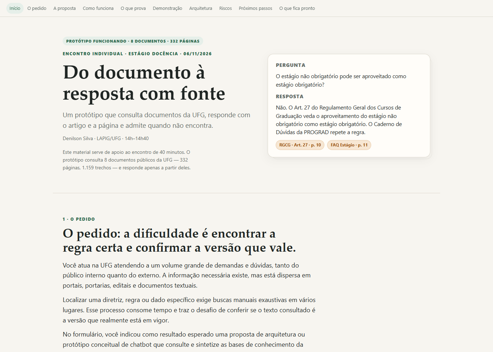

# Do documento à resposta com fonte

**Um protótipo de assistente que consulta documentos públicos da UFG, responde com o artigo e a página e admite quando não encontra.**

Encontro individual do Estágio Docência · LAPIG/UFG · 06/11/2026 · Denilson Silva.

- **Ver a página:** <https://victorgit10.github.io/denilson-ufg-chatbot/>
- **Repositório:** <https://github.com/VictorGit10/denilson-ufg-chatbot>



## O que é

Uma prova de conceito local de um assistente para consultar documentos institucionais. O protótipo:

- indexa **8 documentos públicos da UFG**, com **332 páginas** e **1.159 trechos**;
- recupera poucos trechos por pergunta (busca lexical BM25, com sinônimos e ajustes por tipo de pergunta);
- pede ao modelo uma resposta **somente com base nesses trechos**;
- exige **citação por número** e confere se cada citação existe no conjunto recuperado;
- não aceita como fonte uma citação fora do conjunto;
- mostra o **documento, o artigo ou a seção, a página** e um botão que abre o PDF naquele ponto;
- responde **“não encontrei”** quando a informação não está no corpus.

O corpus é uma amostra, não a UFG inteira. O protótipo é uma demonstração, não um sistema de produção.

## O corpus

| Documento | Tipo | Páginas | Trechos | Status |
|---|---|---:|---:|---|
| Estatuto da UFG (2021) | Estatuto | 58 | 280 | vigente |
| Regimento Geral da UFG (2015) | Regimento | 45 | 238 | vigente |
| Regulamento Geral dos Cursos de Graduação (2012) | Resolução | 36 | 169 | vigente |
| PDI 2023–2027 | Plano | 141 | 282 | vigente |
| Regulamento da Pós-Graduação Stricto Sensu (2023) | Resolução | 28 | 130 | vigente |
| Caderno de Dúvidas Frequentes — Estágio (2015) | Material de apoio | 14 | 19 | orientação |
| Edital PROGRAD nº 258/2026 — Monitoria | Edital | 8 | 38 | vigente |
| Retificação do Edital 258/2026 | Retificação | 2 | 3 | retificação |

Os PDFs estão em `documentos/`. Os metadados, com a URL oficial de cada um, estão em `dados/documentos.json`.

## Como funciona

1. **Extração** — `pdftotext -layout` lê cada PDF página por página.
2. **Corte** — o texto é dividido em trechos que guardam documento, artigo ou seção e página. Nos documentos jurídicos, o corte respeita o artigo; nos demais, respeita a página e a seção.
3. **Busca** — BM25 lexical com normalização de acentos, radicais leves, sinônimos e ajustes por tipo de pergunta (valor, prazo, nota, lista, versão). A busca roda no navegador.
4. **Resposta** — o modelo recebe no máximo 10 trechos numerados e a pergunta. Ele devolve JSON com `resposta`, `citacoes`, `encontrado` e `observacao`.
5. **Conferência** — o site valida as citações contra os trechos recuperados, descarta as inválidas e monta os cartões de fonte com link para o PDF na página.

O modelo dos exemplos gravados é o **deepseek-v4.1-flash** (Ollama Cloud), em 05/11/2026. O modo ao vivo permite escolher outro modelo.

## Demonstração

A página tem dois modos:

- **Exemplos gravados** — 5 respostas geradas pelo modelo e salvas. Funcionam sem chave e sem internet.
- **Ao vivo com sua chave** — você cola a sua chave da Ollama Cloud, escolhe o modelo e faz a pergunta. A chave fica só no seu navegador; se marcar “lembrar nesta aba”, vai para o `sessionStorage`, não para o `localStorage`.

### Por que existe um proxy

A API da Ollama (`https://ollama.com/api/chat`) não devolve cabeçalhos CORS, então o navegador bloqueia a chamada direta. O `worker/worker.js` é um Cloudflare Worker que:

- aceita apenas as origens permitidas (`https://victorgit10.github.io` e `http://localhost:8000`, entre outras);
- aceita apenas os modelos do protótipo;
- repassa a requisição para `https://ollama.com/api/chat` com o `Authorization` do usuário;
- **não guarda nem registra a chave**.

O endereço público do proxy fica em `assets/config.js`. Ele não é segredo.

## Rodar localmente

```bash
# na pasta do projeto
python -m http.server 8000
```

Abra <http://localhost:8000>. Não abra `index.html` direto no disco: o navegador bloqueia o `fetch` dos JSON em `file://`.

### Regerar o corpus

Requer `pdftotext` no PATH (Poppler).

```bash
python codigo/ingerir.py
```

Isso lê os PDFs de `documentos/`, aplica a limpeza e grava `dados/documentos.json` e `dados/trechos.json`.

### Rodar a avaliação da busca

```bash
node codigo/avaliar.mjs
```

O resultado sai no terminal e em `dados/avaliacao_resultado.json`. O teste tem 16 perguntas escritas a partir dos documentos; **não é um conjunto independente**.

### Gerar os exemplos gravados (opcional)

Requer uma instância local da Ollama com o modelo `deepseek-v4.1-flash:cloud` e sessão autenticada.

```bash
node codigo/gerar_exemplos.mjs
```

Isso sobrescreve `dados/exemplos.json`. Se você mudar o corpus, gere de novo para manter as respostas coerentes.

### Publicar o proxy

```bash
cd worker
npx wrangler deploy
```

Copie a URL devolvida para `assets/config.js` e ajuste a lista `ORIGENS` em `worker/worker.js` se o site mudar de endereço.

### Publicar a página

O repositório é estático. No GitHub, em **Settings → Pages**, escolha a branch `main` e a pasta `/ (root)`. O arquivo `.nojekyll` já está incluído.

## Como adicionar documentos

1. Coloque o PDF em `documentos/`.
2. Adicione um bloco em `DOCUMENTOS` no `codigo/ingerir.py` com `id`, `arquivo`, `titulo`, `orgao`, `tipo`, `data`, `status`, `url_oficial` e `descricao`.
3. Rode `python codigo/ingerir.py`.
4. Rode `node codigo/avaliar.mjs` e confira a busca.
5. Atualize os números fixos do texto da página (8 documentos, 332 páginas, 1.159 trechos) e, se quiser, as perguntas de `dados/avaliacao.json`.
6. Se mudar o corpus, gere novos exemplos com `node codigo/gerar_exemplos.mjs` ou ajuste `dados/exemplos.json` à mão.

## Resultados da avaliação

| Métrica | Resultado |
|---|---:|
| Fonte esperada no 1º lugar | 15 de 16 (93,8%) |
| Fonte esperada nos 3 primeiros | 16 de 16 (100%) |
| Documento certo nos 3 primeiros | 100% |
| MRR | 0,97 |

**Cuidado:** as 16 perguntas foram escritas depois da leitura dos documentos e a busca foi ajustada nelas. O resultado mostra que o mecanismo funciona, não que o sistema tem essa acurácia em produção.

## Limites

- 8 documentos, todos públicos; não é a UFG inteira.
- Sem OCR; PDFs digitalizados ficam fora ou entram com perda.
- Sem permissão por usuário; o índice é público.
- Sem avaliação com usuários reais.
- Sem integração com SEI, portais ou Google Drive.
- Sem SLA, monitoramento ou atualização automática.
- A busca é lexical; a próxima camada é híbrida (lexical + semântica + reranker).

## Segurança e chave de API

- **Nenhuma chave de API está no repositório.**
- O site não usa `localStorage` para a chave; o padrão é memória, com opção de `sessionStorage` por aba.
- O Worker não guarda a chave e não registra o corpo da requisição.
- O Worker limita origem e modelos; para produção, adicione autenticação, rate limit e SSO.
- Se você publicar em outra conta ou domínio, ajuste `ORIGENS` no Worker.

## Estrutura

```
index.html                 página do encontro e demonstração
assets/estilo.css          estilo
assets/app.js              interface, exemplos e modo ao vivo
assets/busca.js            índice BM25 e busca (navegador e Node)
assets/config.js           URL do proxy e modelos (sem chave)
dados/documentos.json      metadados dos 8 documentos
dados/trechos.json         os 1.159 trechos
dados/avaliacao.json       16 perguntas de teste
dados/avaliacao_resultado.json
dados/exemplos.json        5 respostas gravadas
documentos/                os 8 PDFs públicos
codigo/ingerir.py          extração e corte
codigo/avaliar.mjs         avaliação da busca
codigo/gerar_exemplos.mjs  geração das respostas gravadas
codigo/testar_busca.mjs    teste rápido de consultas
worker/worker.js           proxy Cloudflare
worker/wrangler.toml
docs/escrita/              briefings e textos que deram origem à página
ROTEIRO-ENCONTRO.md        roteiro de 40 minutos
```

## Licença

Texto, página e figuras: **CC BY 4.0**. Código: **MIT**. Os documentos pertencem à UFG e às fontes originais; os links oficiais estão em `dados/documentos.json`.

---

Feito por Victor Amaral para o encontro individual de Denilson Silva · LAPIG/UFG · 06/11/2026.
